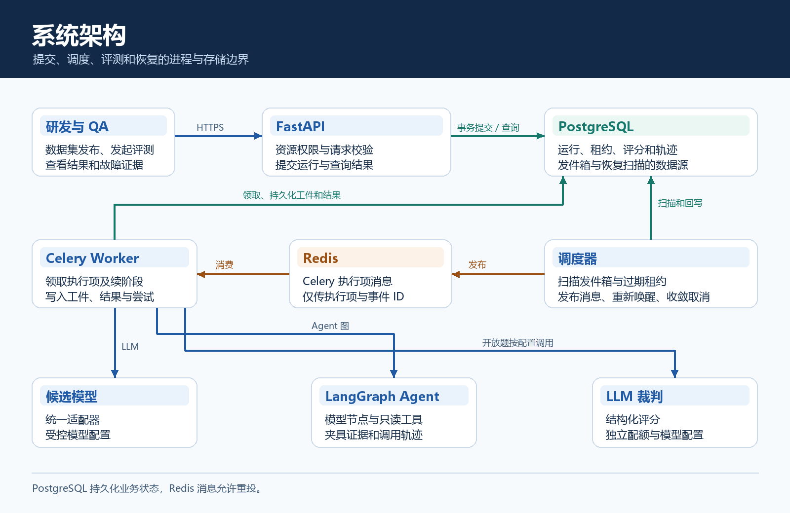

# LLM Agent Evaluation Platform

**当前状态：M0 设计基线 v0.2。M1 尚未开始。** 本仓库已交付设计文档、测试规格与 AI 编码规范。应用、CI 和部署环境依里程碑交付。

面向模型研发、Agent 研发和 QA。模型、Prompt 或工具升级后，团队需要用同一批数据复跑并定位偏差。平台固定数据版本、运行配置和评分口径，保存每个样本的执行、评分和成本证据，支持可复现的回归比较。

## 核心功能与阶段

- **M1 基础实现。** 数据集版本化和 JSONL 导入、基础 API、Fake Model Provider、确定性评分器。通过开发脚本验证执行逻辑。
- **M2 异步可靠性。** 多模型批量评测、按执行项调度、状态查询、取消、重试和故障恢复。
- **M3 Judge 与用量。** 真实模型适配、LLM-as-a-Judge、Token、延迟与费用统计及预算控制。
- **M4–M6 扩展。** M4 评测 LangGraph Agent 工具轨迹，M5 交付 Vue 管理台和 P0 上线验证，M6 扩展回归报告与发布门禁。

## 技术栈

Python 3.12、uv、FastAPI、Pydantic 2、PostgreSQL 17、SQLAlchemy 2、psycopg 3、Alembic、Celery、Redis、LangGraph、Vue 3、TypeScript、Vite、Docker Compose、pytest、Ruff、GitHub Actions。引入顺序见 [技术选型](docs/02-tech-stack.md)。

## 架构

上图沿用 v0.1 的目标拓扑。M1 仅落地 FastAPI、PostgreSQL 与进程内领域执行，按阶段启用后续组件。 [系统架构设计](docs/03-architecture.md)

## 文档导航

| 文档 | 内容 |
| --- | --- |
| [01 项目需求](docs/01-requirements.md) | 功能范围和验收 |
| [02 技术选型](docs/02-tech-stack.md) | 技术栈、并发和开源参考 |
| [03 系统架构](docs/03-architecture.md) | 分阶段实现、消息确认、恢复与安全 |
| [04 数据库设计](docs/04-database-design.md) | 数据模型、事务、用量、快照和审计 |
| [05 API 接口设计](docs/05-api-design.md) | 分阶段路由、Schema、幂等及错误 |
| [06 测试计划与用例](docs/06-test-plan.md) | 用例编号、阶段和验收 |
| [07 AI 评测方案](docs/07-evaluation-design.md) | 评分公式、证据、轨迹和回归 |
| [08 部署与运维](docs/08-deployment.md) | 配置、环境、发布和恢复 |
| [09 开发进度](docs/09-development-progress.md) | 里程碑、版本记录和待确认事项 |
| [10 M1 实施任务](docs/10-implementation-tasks.md) | 任务依赖、文件范围和测试命令 |
| [11 Vibe Coding Prompts](docs/11-vibe-coding-prompts.md) | 每个任务独立可复制的 Prompt |
| [AGENTS.md](AGENTS.md) | 仓库级 AI 编码规范 |

## 本地开发环境

M1 准备 Git、Python 3.12、uv 和 Docker Compose v2。Windows 可以使用 Docker Desktop 的 Linux 容器模式。M1 先启动 PostgreSQL 17，使用 uv 管理虚拟环境和锁文件。M2 加入 Redis、Celery Worker 和 Dispatcher，M5 的 Vue 工程再增加 Node.js 构建环境。

按 [M1-01](docs/10-implementation-tasks.md#m1-01-工程初始化) 开始，验证 Python 版本、依赖锁及测试入口。规划目录为 `backend/`、`tests/`、`scripts/` 和 M5 的 `frontend/`。Compose、Dockerfile 和 `.env.example` 随 M1 对应任务交付。
