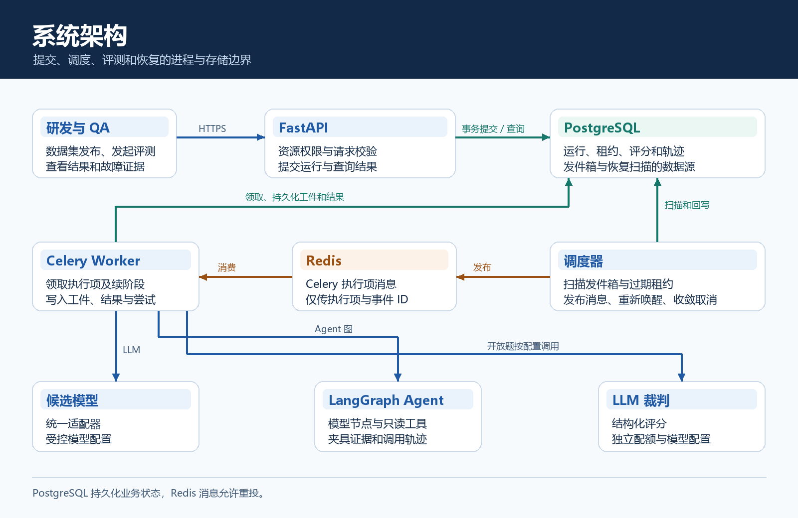

# 03 系统架构设计

状态 **设计基线 v0.1**

## 组件边界

| 组件 | 职责 | 运行入口规划 |
| --- | --- | --- |
| API | 鉴权、校验、版本发布、创建运行、读取进度和证据 | `backend.app.main:app` |
| 领域服务 | 数据集、运行状态、执行租约、评分协议、取消规则 | `backend/app/domain/` |
| 调度进程 | 扫描发件箱、派发和回收执行项、推进已取消项 | `python -m backend.app.dispatcher` |
| Celery Worker | 按执行项请求候选、记录工件、评分、回写结果 | `backend.app.worker:celery_app` |
| 适配与评分 | 统一模型、LangGraph 工具、规则和裁判适配器 | `backend/app/adapters/`、`backend/app/evaluation/` |
| PostgreSQL / Redis | PostgreSQL 持久化所有业务状态。Redis 传递唤醒消息和辅助限速 | 独立服务，使用私网 |

候选与裁判走独立并发/流量预算。执行队列区分 `eval_llm` 与 `eval_agent`。外部 I/O 发生在数据库事务之外。消息仅含执行项 ID 和发件箱事件 ID。

## 从提交到结果

1. API 按已发布版本枚举样本，校验候选类型和评分配置。在同一事务写入 `runs`、`run_targets`、`run_items`、初始 `outbox_events`，提交后响应 202。
2. 调度器依 `available_at` 领取待发送事件，使用 `FOR UPDATE SKIP LOCKED` 和发布租约。提交领取事务后向 Redis 发布 Celery 消息，再用发行令牌回写 `sent_at`。不确定是否已发布时允许重复发布。
3. Worker 在短事务领取到期执行项，增加尝试次数、分配随机租约令牌，写尝试记录。未到期、已持有有效租约或已终止的项直接退出。需要换阶段时先提交候选工件、轨迹和阶段状态，再执行评分。
4. Worker 完成后校验令牌和租约期限，在一个事务写结果、结束尝试并推进项及运行状态。每次完成、失败、取消或重试按固定顺序先锁运行行再锁执行项，汇总以执行项状态为准。终态结果唯一，读取时可从明细重建摘要。
5. 调度器周期性扫描发送超时事件、可能丢失唤醒的到期项和过期执行租约。生成带递增 `dispatch_seq` 的新事件。对持续未领取的已发送项使用冷却和频率限制，过期尝试按预算重新唤醒或落失败终态。旧 Worker 的写入需通过租约校验。

首轮参数建议为候选和裁判各 25 秒调用上限、每执行项尝试软/硬期限 100/120 秒、租约 150 秒、Redis 可见性超时 300 秒。Agent 全图时间纳入候选执行阶段，退避由数据库的 `available_at` 控制。用故障测试验证 Redis 可见性、Worker 退出和数据库扫描联动，不以 Celery 状态作为业务状态。 [Celery 任务与确认行为](https://docs.celeryq.dev/en/stable/userguide/tasks.html)

## 状态与取消

| 对象 | 转换与约束 |
| --- | --- |
| 执行项 | `queued → running`，暂态故障 `running → retry_wait → running`。终态为 `succeeded / failed / cancelled`，终态不可逆 |
| 运行 | `queued → running`，接受取消后 `queued/running → cancel_requested`。所有项终止后，按取消已接受 → `cancelled`；全部成功 → `succeeded`；成功和失败并存 → `partial_failed`；全部失败 → `failed` |
| 取消 | API 与领取/完成事务通过运行行串行化。待处理项由调度器标记取消，在途执行于阶段边界停止。取消先提交时，晚到写回只能结束为取消，保留已提交的工件及之前成功的结果。已终止运行返回冲突 |

质量低分属于成功完成评分。候选或裁判在必需阶段最终失败属于执行失败。Agent 到达步数限制时，如果有可核验的终止证据，可记录为成功评分、业务未完成。

## 失败与恢复

| 故障 | 行为 |
| --- | --- |
| PostgreSQL 提交后 Redis 暂不可用 | 已受理运行保持排队，恢复后从发件箱派发，并告警积压年龄 |
| 发布成功但未标记、Redis 重投 | 允许重复消息，由执行项领取锁、令牌和结果唯一键去重 |
| 消息已发送后 Redis 数据丢失 | PostgreSQL 扫描未领取项并重新派发 |
| Worker 被终止或租约过期 | 关闭旧尝试，尝试额度内重新派发；审计区分供应商调用结果未知 |
| 裁判失败 | 已提交的候选工件与工具轨迹跨重试复用，裁判计入独立错误分类 |
| 调用供应商成功后进程崩溃，工件尚未提交 | 可能出现重复第三方请求和计费。供应商支持幂等时使用稳定请求 ID，未知消耗单独统计 |

建议每项最多 3 次尝试（含首次），带抖动退避。重试网络暂态、超时、受预算约束的 429 和选定的 5xx；鉴权、无效配置和确定性契约错误直接终止。预算、熔断和背压的参数在预发演练后固定。

## 权限和可观测性

API 对每个资源执行服务端权限检查，管理接口只接受受控的候选/裁判配置，外发端点走部署白名单。Agent 工具限于代码注册、确定性、只读夹具。候选输入和回答作为数据处理，统一脱敏。日志可按 `request_id`、`run_id`、`item_id`、`attempt_no` 查询，指标使用受控枚举标签。
