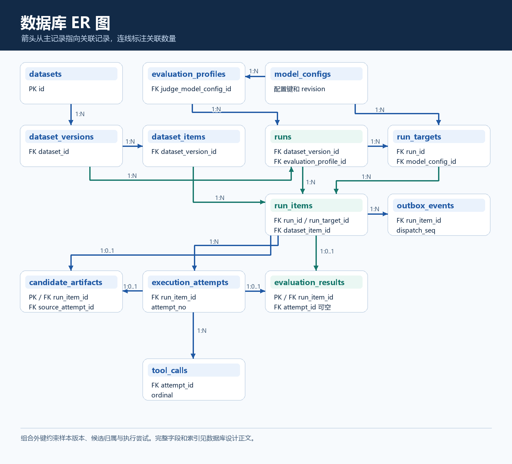

# 04 数据库设计

状态 **设计基线 v0.1** · PostgreSQL 17

## 约定

业务主键用 UUID，外部 JSON 使用 UUID 字符串。时间字段用 `timestamptz`，API 以 UTC/RFC 3339 表达。金额用 `numeric(18,8)` 并保存币种、价格版本和已知/未知状态。载荷用 JSONB，服务端用 Pydantic 校验；索引优先覆盖规范化关系字段。所有表默认非空，表中 `?` 代表允许 NULL。

## 表定义

| 表 | 字段设计 | 约束与一致性 |
| --- | --- | --- |
| `datasets` | `id, name, kind, description, created_by, created_at, archived_at?` | `UNIQUE(name)`；kind 为 llm 或 agent；归档只阻止新运行 |
| `dataset_versions` | `id, dataset_id, version_no, status, checksum?, item_count, created_at, published_at?` | `UNIQUE(dataset_id,version_no)`；draft/published；发布时锁版本行，固定校验和、顺序和数量 |
| `dataset_items` | `id, dataset_version_id, case_key, ordinal, input JSONB, expectation JSONB, tags text[], created_at` | `UNIQUE(dataset_version_id,case_key)`、`UNIQUE(dataset_version_id,ordinal)`；版本发布后禁止变更 |
| `model_configs` | `id, config_key, revision, kind, adapter_key, provider, model_name, provider_endpoint_ref, credential_ref?, parameters JSONB, created_at, disabled_at?` | `UNIQUE(config_key,revision)`；用于候选或裁判；revision 内执行配置不可编辑；禁用影响新运行 |
| `evaluation_profiles` | `id, profile_key, revision, kind, evaluator_config JSONB, judge_model_config_id?, created_at, disabled_at?` | `UNIQUE(profile_key,revision)`；固定规则、rubric、Judge prompt 和指标版本 |
| `runs` | `id, dataset_version_id, evaluation_profile_id, baseline_run_id?, created_by, idempotency_key, request_hash, status, repeat_count, total_items, created_at, started_at?, finished_at?, cancel_requested_at?` | `UNIQUE(created_by,idempotency_key)`；单份请求摘要；从有效明细推导进度 |
| `run_targets` | `id, run_id, model_config_id, ordinal, execution_snapshot JSONB` | `UNIQUE(run_id,model_config_id)`、`UNIQUE(run_id,ordinal)`；快照保存已解析的非秘密执行与评测版本 |
| `run_items` | `id, run_id, run_target_id, dataset_version_id, dataset_item_id, repeat_no, status, attempt_count, dispatch_seq, available_at, dispatched_at?, lease_token?, lease_until?, updated_at` | `UNIQUE(run_target_id,dataset_item_id,repeat_no)`；组合外键强制目标、样本与运行使用对应版本 |
| `execution_attempts` | `id, run_item_id, attempt_no, stage, outcome?, error_code?, started_at, ended_at?, usage JSONB?` | `UNIQUE(run_item_id,attempt_no)`；结束失败、重试、过期或取消均有记录，未知用量可为空 |
| `candidate_artifacts` | `run_item_id PK/FK, source_attempt_id, output JSONB, finish_reason, latency_ms, usage JSONB?, created_at` | 每执行项一个已提交工件；和最终候选工具轨迹同事务持久化，评分重试可复用 |
| `tool_calls` | `id, attempt_id, ordinal, tool_name, argument_summary JSONB, output_summary JSONB?, status, latency_ms?, error_code?` | `UNIQUE(attempt_id,ordinal)`；有效轨迹由工件的 `source_attempt_id` 决定；失败/中断轨迹可按尝试排查 |
| `evaluation_results` | `run_item_id PK/FK, attempt_id?, outcome, final_score?, rule_score?, judge_score?, task_completed?, error_code?, evidence JSONB, candidate_usage JSONB?, judge_usage JSONB?, created_at` | 每终态执行项一条，取消可无尝试；分数 `numeric(5,4)` 且 0–1。失败和取消的最终分为空 |
| `outbox_events` | `id, run_item_id, dispatch_seq, available_at, publish_token?, publish_lease_until?, sent_at?, publish_attempts, last_error?` | `UNIQUE(run_item_id,dispatch_seq)`；发布超时可重领，独立发布令牌保护回写 |

## 约束和访问路径

- 为 `runs(id,dataset_version_id)`、`run_targets(id,run_id)`、`dataset_items(id,dataset_version_id)` 建组合唯一约束，供 `run_items` 的组合外键使用。结果和候选工件的尝试 ID 以 `(attempt_id,run_item_id)` 约束同一执行项。
- 外键默认 `RESTRICT`。计数、顺序、耗时和 token 非负，`repeat_no` 从 1 开始。用 CHECK 校验状态值、终态时间和租约字段配对。状态转换由事务条件更新校验。
- 数据集发布、导入共用版本行锁；校验和按明确字段和 ordinal 的 canonical JSON 序列计算 SHA-256。发布后禁止更新样本，测试覆盖仓储路径及并发导入。
- 列表索引 `runs(created_at DESC,id DESC)`、`run_items(run_id,status,id)`、`run_items(run_target_id,id)`。到期项索引对 queued/retry_wait 的 `(available_at,id)` 和 running 的 `(lease_until,id)` 分别建立部分索引。
- 发件箱使用 `(available_at,id) WHERE sent_at IS NULL` 的部分索引。消息发布频率受冷却限制，清理已发送事件须确保对应执行项已终止并满足审计窗口。

## 事务、迁移与保留

创建运行整批提交。最终完成时在单事务写结果并推进状态。归档数据集不删除历史运行；证据过期按审批执行内容脱敏、清理或整组删除，备份遵循同等留存策略。

Alembic 管理版本，发布前用空库和上一版脱敏快照验证升级。增量迁移按扩展、回填、收缩推进。大表索引构建和回填需在预发演练锁影响。生产在线数据、评分证据和备份的保留期限见 [待确认决策](09-development-progress.md#待确认决策)。
