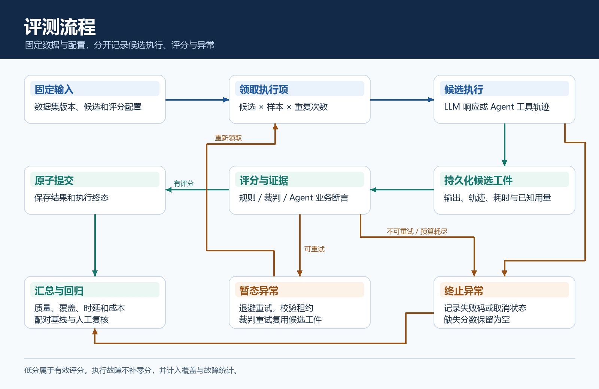

# 07 AI 评测方案

状态 **设计基线 v0.2**

上图为 v0.1 目标流程，M1 直接运行候选和规则评分，M2 接入调度与恢复，M3 启用 Judge，M4 启用 Agent。

## 输入与实验版本

样本保存任务输入、参考答案或预期业务状态、允许的工具路径、标签。评分配置固定规则、裁判维度、权重、阈值、prompt 版本和指标版本。运行固定数据 checksum、候选和裁判配置版本、Agent 图和工具夹具版本、参数、重复次数及执行时段。供应商实际返回的模型标识和用量按能力记录。重复执行使用相同输入和配置，记录样本内方差。

数据按场景和难度分层，拆分调试集、人工校准金标和独立发布验收集。按业务实体或来源分组去重后切分，防止相似问题跨集合。回归变更需记录失败样本、口径变更及数据版本。

## 规则与裁判

| 评分方式 | 使用场景 | 规则 |
| --- | --- | --- |
| 精确匹配 | 枚举、短答案 | 经配置执行 NFKC、首尾空白处理和 casefold，匹配任一可接受答案；业务 ID 可关闭归一化 |
| 数值比较 | 金额、比例 | 采用十进制，显式单位，误差 ≤ max(绝对容差, 相对容差 × 参考值绝对值)；布尔、NaN 与 Infinity 无效 |
| JSON 结构 | 信息抽取 | 对象键无序，数组有序，字段类型和值均需匹配。额外字段默认拒绝，可按规则显式允许。布尔值与数值是不同类型 |
| LLM 裁判 | 开放问答 | 维度 0–4，覆盖正确性、完整性及证据支持；每维返回评分理由和证据引用，服务端重算归一化分 |
| Agent 业务判定 | 工具链任务 | 读取夹具最终状态或工具可观测结果，独立核验目标是否实现；必要约束作为硬门禁 |

开放问答以正确性为例，0 表示核心结论错误或无关，1 表示主要内容有误，2 表示核心结论部分正确或关键条件缺失，3 表示正确且有轻微缺漏，4 表示完全正确。每个维度配置独立锚点。

### 计算与缺失处理

- 配置显式列出每项的正权重、`required` 和 `hard_gate`。规则项输出 0 或 1。有效 Judge 分为 0–4 的严格整数，归一化为 `raw/4`。每个阶段的分数为 `sum(weight × normalized_score) / sum(weight)`，分母只计有效项。Rule Score 与 Judge Score 用同一公式独立计算。
- 候选输出无法满足规则的格式、内容或容差是有效的规则失败，分数为 0。缺少必需期望、评分器异常、必需 Judge 维度缺失或无效属于技术失败，按照错误分类重试或落失败，`final_score=null`。选配维度缺失时排除其权重并记录原因及权重覆盖率，显式的非法值仍按 schema 拒绝。整个阶段无有效维度时返回 null，若该阶段必需则技术失败，否则排除阶段权重。所有启用阶段均无可用分时技术失败。
- 最终分按有效 Rule Score 与 Judge Score 的阶段权重重新归一。硬门禁必须同时标为 required，规则门禁要求命中，Judge 门禁需要配置归一化通过阈值。低于阈值将有效最终分设为 0，必需技术失败优先返回 null。只有成功计算才将 `outcome` 写为 succeeded。内部用 Decimal，最终落库和返回前统一 HALF_UP 到 4 位小数，阶段计算使用未舍入值。
- 示例中规则两项分数 1 和 0，权重 3 和 1，Rule Score=0.7500。Judge 两个必需维度得 3 和 4，权重 2 和 1，第三个权重 1 的选配维度缺失。Judge Score=(2×0.75+1×1)/3=0.8333，Judge 权重覆盖率 3/4。阶段权重为规则 0.4、Judge 0.6，最终分 0.8000。若必需维度缺失且修复失败，结果为 failed、最终分 null。
- 评分器位于纯 Python 模块，输入为候选工件、期望和已验证配置，输出 `ScoreResult`，含阶段分、最终分、状态、错误及证据。M1 可单独调用规则评分器，LangGraph 节点只生成候选工件与轨迹，评分在外侧组合。

### Judge Schema 与不可信输入

Judge 使用独立模板、匿名候选和预先生成的证据索引。响应为 `{dimensions: [{name, score, reason, evidence_refs}]}`，拒绝额外字段、重复维度、未知维度、非严格整数或越界分数。理由长度 1–1,000 字符，证据引用为服务端分配的字符串 ID 列表，最多 10 项。配置要求证据的维度至少一项，服务端校验引用属于本次样本允许的片段（如 candidate:1 或 reference:2）。保存验证过的引用、规则及 Prompt 版本和脱敏理由。非法输出可执行一次占预算的格式修复，仍失败记 `JUDGE_INVALID_OUTPUT`。

候选输出、参考内容和工具返回均是不可信数据，作为结构化数据片段传递，Judge 无工具和凭据。测试注入候选文本要求改分、输出越权证据引用或附加字段。CI 夹具验证指令不进入系统模板、非法结果被拒绝，人工金标复跑检验真实 Judge 的评分偏移。 [MT-Bench 裁判研究](https://arxiv.org/abs/2306.05685)

### 裁判校准

- 初次建议选取至少 100 条经分层的金标样本，两人独立打分，分歧由第三人复核。模型或 rubric 版本变化后复跑固定金标。
- 报告人际及裁判对人工的加权 Cohen κ、相差超过 1 档的比例、各标签偏差和解析成功率。建议试点目标为 κ ≥ 0.70、严重偏差比例 ≤ 10%、解析成功率 ≥ 99%；业务阈值由验收方确认。
- 从金标之外抽取关键任务及边界样本，检验冗长错误、复制参考答案、反指令文本及评分漂移。后续启用成对裁判时交换 A/B 顺序，分歧提交人工复核。

## Agent 评测

LangGraph 使用模型节点、注册工具节点与终止节点。每次评测在隔离夹具内运行，限制步数、执行时长与可调用工具。记录工具名、顺序、规范化参数、返回摘要、耗时及错误。评分依据任务目标和可观察轨迹，失败尝试与最终候选工件可分别审查。

工具路径允许多个等价分支。对每份预期路径按其顺序约束做最大一对一匹配，并按固定规则选匹配数最大的可行路径；平手选所需调用较少的路径，再按路径 ID 排序。匹配条件包含工具名、参数谓词与成功状态。调用最多匹配一次，错参、失败或重复调用进入实际调用分母。调用数据缺失时标记指标不可用。样例：预期成功查询订单 123 一次，实际对 123 成功两次且对 456 成功一次，准确率 1/3，必需调用召回率 1/1。

## 指标口径

| 指标 | 分子、分母或统计对象 |
| --- | --- |
| 执行成功率 | 成功评分执行项 / 已终止且未取消的执行项；取消另计 |
| 平均质量分 | 成功评分且有分数的执行项的算术平均，附样本数量和执行覆盖率 |
| Agent 任务完成率 | 业务目标通过 / 成功评分且有任务判定的 Agent 执行项；达步数上限且目标未达成计失败 |
| 工具调用准确率 | 匹配调用数 / 可完整评估轨迹的实际调用数，按候选微平均；无实际调用时为空 |
| 必需调用召回率 | 匹配的必需调用数 / 所选路径要求的必需调用数；无必需调用时为空 |
| 候选 P50/P95 | 成功持久化的候选工件耗时，按 nearest-rank，分别报告排队、裁判和端到端运行耗时 |
| Token 与估算费用 | 从 usage_records 按 candidate/judge 分组，另标 attempt_no > 1 的重试切片，切片包含在总量中。附覆盖率、价格版本、币种及未知调用次数 |

分母为 0 时返回 null。质量、任务完成率和工具指标需同时展示覆盖率与执行失败计数，避免少量成功样本造成偏高解释。厂商未报告用量时保留 null。若进行估算，用独立字段标注方法；禁止把估算和已报告值合并成实测。

## 发布回归（M6，P1）

对固定数据校验和、评分版本、厂商适配器语义与可比执行条件，按 `case_key × repeat_no` 对齐基线与候选。报告配对覆盖率、质量差、完成率差、延迟比、异常样本和按样本聚类 bootstrap 的置信区间。候选本身允许变更；若裁判或测量语义变更，先用新口径重跑基线。试点建议配对覆盖率 ≥ 95%，质量差不低于 −0.02，Agent 完成率差不低于 −2 个百分点，候选 P95 延迟比 ≤ 1.20。零基线耗时或覆盖不足时给出证据不足。正式门禁按场景审批，保存规则版本和人工复核结论。
